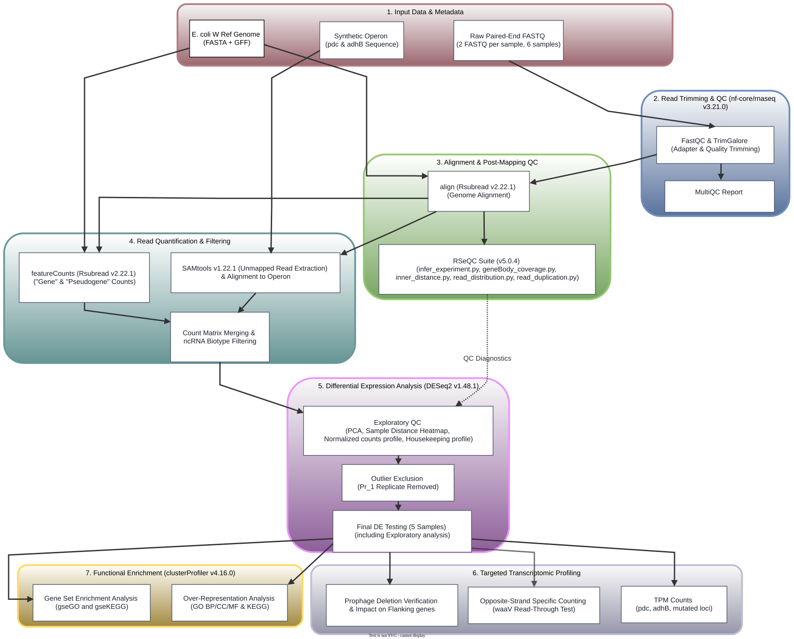

# Transcriptomic Characterization of an Adaptively Evolved, Ethanol-Tolerant *Escherichia coli* Strain

## Overview
This repository contains the complete bioinformatics pipeline (R scripts, bash scripts, input files and output files) used to analyze the transcriptomic profile of an adaptively evolved, ethanol-tolerant *Escherichia coli W* strain (W105Fe) compared to its parental strain (W105F). 

The parental strain(W105F) was actually an engineered strain where a synthetic operon (*pdc* and *adhB*) was chromosomally integrated   and some genomic regions (*ldhA*, *frdAB* operon, *focA-pflB*) were deleted with a purpose to direct lactose fermentation into bioethanol production. But, the ethanol produced by it inhibits its own growth if the concentration gets too high. To overcome the  growth inhibition caused by ethanol toxicity, the strain was subjected to Adaptive Laboratory Evolution (ALE) where the parental strain was allowed to grow under ethanol stress and the ethanol concentration was increased with each culture. The ones surviving the highest ethanol concentration were then selected which were termed as Evolved Strain in this work (W105Fe). 

## Sample Design:
For transcriptomic analysis, the sample design consisted of 3 biological replicates of each of the two conditions: 3 biological replicates of parental strain and 3 biological replicates of evolved strain.  All of the replicates were initially pre-cultured in LB (Lysogeny Broth)+4% lactose. Then, they were grown into pellets in fermentation medium (Concentrated Whey Permeate with PIPES and ammonium sulphate) before being subjected for RNA sequencing. RNA sequencing was done using NovaSeq X Illumina with 2*150bp paired end format meaning that two paired end reads were generated from each strand and the read length was targeted to be 150bp long.

### *Note on Data availability:*
*Due to file size constraints on GitHub, the raw, paired-end FASTQ files including the intermediate bam files which are larger than Github's allowed size are not uploaded in this repository. The scripts used for this analysis including the outputs (and the inputs provided they fall within the size limit) are provided here.*

# Pipeline

<p align="center">
  
</p>

## Pre-processing:
To execute the initial pre-processing steps, the following system dependencies were installed: `Java Runtime Environment` (`OpenJDK` v21.0.8), `Nextflow` (v25.04.7) and `Docker` (v28.4.0).

To install `OpenJDK` v21.0.8, you can run the following command in the command line:
```bash
sudo apt update
sudo apt install openjdk-21-jre-headless -y
```

`Docker` can be installed by following the instructions from this link: https://docs.docker.com/

For `Nextflow` (v25.04.7), you can run the following command:
```bash
# Export the variable NXF_VER into your current terminal so that it can be recognized by the nextflow downloading script
export NXF_VER="25.04.7"

# Download nextflow
curl -s https://get.nextflow.io | bash

# Move it to your system's PATH so you can run it from any folder
sudo mv nextflow /usr/local/bin/

# See the version number
nextflow -version
```

To do pre-processing of the paired-end FASTQ files obtained after RNA sequencing, the input for the nextflow pipeline were samplesheet.csv, a csv file containing the file paths and metadata for the paired-end FASTQ files, reference genome in FASTA format (RefSeq accession number: GCF_000258145.1) and its corresponding GFF annotation file. 

The samplesheet.csv would look something like below where you need to specify sample names in "sample" column, file paths for read1 and read2 files under "fastq_1" and "fastq_2" and strandedness protocol under "strandedness".
```csv
sample, fastq_1, fastq_2, strandedness
PARENT_REP1, <path to Read1 file>, <path to Read2 file>, auto
PARENT_REP2, <path to Read1 file>, <path to Read2 file>, auto
PARENT_REP3, <path to Read1 file>, <path to Read2 file>, auto
EVOLVED_REP1, <path to Read1 file>, <path to Read2 file>, auto
EVOLVED_REP2, <path to Read1 file>, <path to Read2 file>, auto
EVOLVED_REP3, <path to Read1 file>, <path to Read2 file>, auto
```
Once you make the samplesheet.csv file, you can run the following command in bash in order to run `nf-core/rnaseq` pipeline. The filepaths must be given in the relevant placeholder here.
```bash
nextflow run nf-core/rnaseq -r 3.21.0 -profile docker \
--input <path_to_samplesheet.csv> \
--outdir <path_to_output_dir> \
--fasta <path_to_reference_genome_file-GCF_000258145.1_ASM25814v1_genomic.fna> \
--gff <path_to_.gff_annotation_file>
```
For this specific project, `nf-core/rnaseq` was utilized exclusively for its read trimming and quality control capabilities only. The pipeline execution was stopped (by pressing `Ctrl+C`) once the `TRIMGALORE` and `FASTQC` processes were shown to be completed and the clean, adapter-trimmed FASTQ files along with the FastQC reports that were obtained in the specified output directory were then used for the downstream analyses. 

To generate MultiQC report, you can run following command in bash:
```bash
#Install multiqc using conda
conda install -c bioconda -c conda-forge multiqc
#Run MultiQC on the directory of FASTQC outputs
multiqc <file path to fastqc reports>
```
The results of this pre-processing step are in the `01_Preprocessing_nfcore_results/` directory.

With pre-processing complete, the downstream steps ranging from alignment to enrichment analysis were done using R (v 4.5.1) and different command line tools. So, to install all required CRAN and Bioconductor dependencies (e.g., `DESeq2`, `Rsubread`, `clusterProfiler`) for R, **`setup_installation.R`** needs to be run first.

## Alignment:
The clean, trimmed FASTQ files were then aligned to the *E. coli W* reference genome (RefSeq accession number: GCF_000258145.1) using `align` function from `RSubread` package (v2.22.1). You can see the full code in the directory `02_Alignment/`.

## RSeQC (Post-Alignment QC):
Post-alignment, the RSeQC package (v5.0.4) was then used to assess library strand specificity (using `infer_experiment.py` script), paired-end insert size distribution (using `inner_distance.py` script), 5′-to-3′ transcript coverage uniformity (using `geneBody_coverage.py` script), read distribution across coding and intergenic regions (using `read_distribution.py` script), and PCR read duplication rates (using `read_duplication.py` script). The instructions to install RSeQC, required packages and to do this analysis are written in the directory named `03_RSeQC/`.


## Read Quantification & RNA Biotypes Filtering:
Read counting was then performed using ```featureCounts``` from the same ```RSubread``` package (v2.22.1) and ```samtools``` in command line in the following ways:

First, all features annotated as "*gene*" in the third column of the reference GFF file, grouped by their unique "*ID*" attribute had their reads counted which gave the counts of all annotated protein-coding genes and non-coding RNA biotypes (such as rRNA, tRNA, etc.). 

Second, all features annotated as "pseudogene" in the third column of the reference GFF file had their reads counted which gave the counts of all annotated pseudogenes. 

Third, chromosomally integrated ethanologenic genes (*pdc* and *adhB*) had their reads counted but the reads were not counted from the original BAM file rather unmapped read pairs were first extracted from the BAM files using ```samtools```, aligned against the synthetic operon sequence file and then quantified using ```featureCounts```. This was because the sequence of these ethanologenic genes were not present in the original reference genome file. So, the reads would not have been mapped to ethanologenic genes using reference genome file.

Ultimately, the three count matrices (that of "gene", "pseudogene" and ethanologenic genes) were then appended and counts of non-coding RNA biotypes (rRNA, tRNA, etc.) were then removed by using their IDs which were identified from the reference GFF annotation file. 

The scripts for each of these steps and the outputs are present in the folder `04_Counting/`.


## Differential expression analysis:
The merged count matrices for all 6 samples were then used for differential expression analysis using `DESeq2` (v1.48.1). Visualizations, including PCA plots, sample-to-sample distance heatmaps, MA plots, normalized count distribution curves, and specific housekeeping gene expression profiles, were generated utilizing `DESeq2`'s built-in functions alongside the `pheatmap` (v1.0.13) and `ggplot2` (v4.0.1) packages.

As Parent-replicate-1 (Pr_1) came out to be outlier in several of the aforementioned exploratory plots and also in several RSeQC reports (you can see in the folder), it was removed and differential expression analysis was done once again by removing Parent-replicate-1. The exploratory visualizations were done in similar way as before to confirm the proper biological clustering within the remaining replicates and the differentially expressed genes were highlighted using volcano plot (using `EnhancedVolcano` v1.26.0) and genome wide expression map.

The scripts for entire DESeq2 analysis and for the plots are in `05_DESeq2_analysis/With_Pr_1/` folder for the one with Parent-replicate-1 and in `05_DESeq2_analysis/Without_Pr_1/` folder for the one when Parent-replicate-1 was removed.

## Targeted Transcriptomic profiling

### A) TPM Counts:
Transcripts Per Million (TPM) values were calculated by normalizing raw counts against gene lengths first and then against sequencing depth. To get gene length of each gene, the reference annotation file (gff file) was imported in R using `read_gff` function of `biomartr` package (v1.0.7) and the columns for start coordinate and end coordinates were assessed to calculate gene length for each gene. These values were particularly used to assess expression efficiency of engineered genes (*pdc* and *adhB*) and to see expression profile of genes in the mutated loci (*yeeJ* and *waaV* loci). 
The results are in `06_Targeted_transcriptomic_profiling/TPM_counts/` folder. 

### B) Opposite Strand-Specific Counting:
Each of the counting steps done previously to get raw counts from BAM file were done using the parameter `strandSpecific=c(0,2,2,2,2,2)`, which is a parameter for `featureCounts` function that takes in values `0`,`1` and `2` for unstranded counting, forward-stranded counting and reverse-stranded counting, respectively. Since `infer_experiment.py` script from RSeQC had shown reverse-stranded sequencing for all samples except Parent-replicate-1 (unstranded), the vector was taken to be `c(0,2,2,2,2,2)`. 

The genomic study done before this transcriptomic study had revealed a mutation in *waaV* gene which was present in the evolved strain but was not present in the parental strain. This had raised a question "Has this mutation caused interruption of transcriptional termination of *waaV* in the evolved strain?". *waaV* is present in such a way it is present in the negative strand while its 3 immediate genes (*rfaC*, *rfaF*, *rfaD*) upstream are present in the positive strand. So, if there was indeed an interruption of transcriptional termination and transcript of *waaV* was formed longer than usual, the reads coming from 3'end (overlapping region) would get mapped onto *rfaC*. Since infer_experiment.py showed that 96.32%-98.86% of the reads were as if sequencing was done according to reverse-stranded protocol, this means more than 96% of Read1s mapping to a certain gene were in opposite direction to the gene.  So, in case of transcriptional termination, the Read1s coming from 3'end of *waaV*, if mapped onto *rfaC* would be in same direction as rfaC which means we needed to see forward-stranded counts. Hence, the counting was done once again using `strandSpecific=c(1,1,1,1,1)` to compare the ratio of forward stranded counts/reverse-stranded counts in parental vs evolved strain.

The results are in `06_Targeted_transcriptomic_profiling/Opposite-strand_specific_counting/` folder.
 
### C) Prophage Region Deletion and Flanking Gene Analysis:
To confirm the deletion of the ~36 kb prophage locus previously identified in the genomic study, normalized counts of the prophage genes (*WFL_RS28210* to *WFL_RS25495*) were evaluated. DESeq2-normalized counts were sufficient for this analysis (rather than Transcripts Per Million, TPM), as the objective was to compare the expression of individual genes across different samples rather than comparing different genes within the same sample. Expression of the immediate flanking genes (*rcdA* and *ybjL*) was also quantified to assess whether the deletion altered local gene expression.

The results are in `06_Targeted_transcriptomic_profiling/Prophage_and_flanking_genes/` folder.

## Functional Enrichment Analysis (ORA & GSEA)
Functional enrichment analysis was conducted using two complementary
methodologies: **Over-Representation Analysis (ORA)** and **Gene Set Enrichment Analysis (GSEA)**.

**Over-Representation Analysis (ORA)** was performed to determine whether specific biological functions or pathways were statistically enriched within the defined list of differentially expressed genes compared to a background list. Here, the background list was the complete list of genes statistically evaluated by DESeq2 (i.e., all protein-coding genes, pseudogenes, and synthetic operon genes excluding those which got filtered out from the pre-filtering step).

Gene Ontology (GO) and KEGG pathway enrichments were performed using the `clusterProfiler` package (v4.16.0). GO enrichment was performed using the `enrichGO` function utilizing the *E. coli K-12* annotation database (`org.EcK12.eg.db` v3.21.0) and BH correction procedure on p-values (p-value cutoff of 0.05 and q-value cutoff of 0.2). The minimum gene set size was set to 3 because *E. coli* possesses numerous metabolic pathways and operons consisting of fewer than 10 genes, which is the software's default minimum. 

**Gene Set Enrichment Analysis (GSEA)** was also conducted through the `clusterProfiler` package, but using the `gseGO` and `gseKEGG` functions for ontology and KEGG pathway enrichment, respectively.
GSEA evaluates the entire continuous list of measured genes to determine whether genes of a certain gene set tend to occur toward the top (or bottom) or are randomly distributed throughout the list. It achieves this by calculating an Enrichment Score
(ES) which is calculated by walking down the ranked list, increasing a running-sum statistic when encountering a gene belonging to the target set and decreasing it when encountering a gene outside of the set.

To prepare the ranked list for this analysis, log2 fold change values of all genes evaluated by DESeq2 were extracted and then concatenated to form a numeric vector
where the corresponding gene symbol was given as a name for each numeric value.
This vector was then sorted in descending order and was then subjected to Gene Ontology GSEA using the `gseGO` function across all three primary ontologies: Biological Process, Cellular Component, and Molecular Function. The analysis was performed with a minimum gene set size of 3, BH p-value adjustment method, and a
p-value cutoff of 0.05. Similarly, KEGG pathway GSEA was also performed using same parameters but with `gseKEGG` function.

The scripts and the results of enrichment analysis are located in the `07_Enrichment_analysis/` directory.

# Workflow order
```
 ┌────────────────────────────────────────────────────────┐
 │  01_Preprocessing_nfcore_results/                      │
 └─────────┬──────────────────────────────────────────────┘
           │
           ▼
 ┌────────────────────────────────────────────────────────┐
 │    setup_installation.R                                │
 └─────────┬──────────────────────────────────────────────┘
           │
           ▼
 ┌────────────────────────────────────────────────────────┐
 │  02_Alignment/                                         │
 └─────────┬──────────────────────────────────────────────┘
           │
           ▼
 ┌────────────────────────────────────────────────────────┐
 │  03_RSeQC/ (Post-Alignment Quality Control)            │
 └─────────┬──────────────────────────────────────────────┘
           │
           ▼
 ┌────────────────────────────────────────────────────────┐
 │  04_Counting/ (Read Quantification & Filtering)        │
 └─────────┬──────────────────────────────────────────────┘
           │
           ▼
 ┌────────────────────────────────────────────────────────┐
 │  05_DESeq2_analysis/                                   │
 └─────────┬──────────────────────────────────────────────┘
           │
           ├─▶ With_Pr_1/ (Initial check)
           │
           ├─▶ Without_Pr_1/ (Final analysis)
           │
           ▼
 ┌────────────────────────────────────────────────────────┐
 │  06_Targeted_transcriptomic_profiling/                 │
 └─────────┬──────────────────────────────────────────────┘
           │
           ├─▶ TPM_counts/
           │
           ├─▶ Opposite-strand_specific_counting/
           │
           ├─▶ Prophage_and_flanking_genes/
           │
           ▼
 ┌────────────────────────────────────────────────────────┐
 │  07_Enrichment_analysis/ (Functional ORA & GSEA)       │
 └────────────────────────────────────────────────────────┘
 ```


